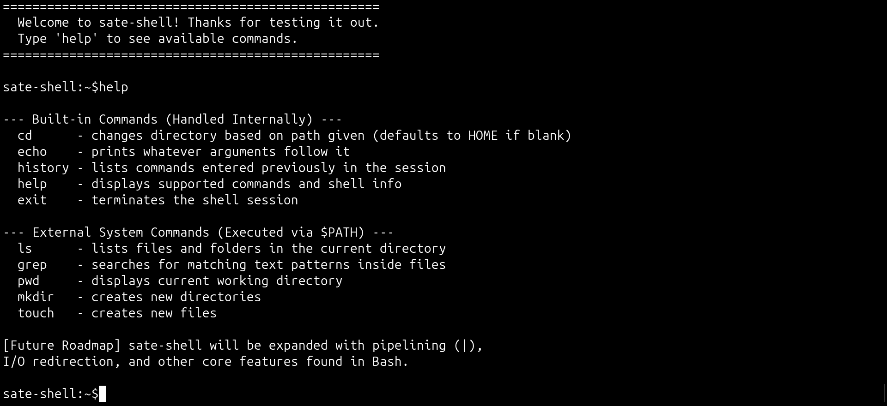
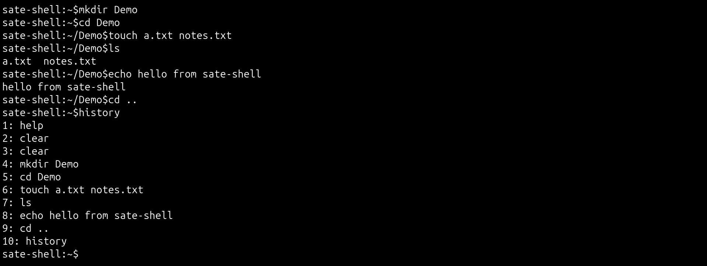

# sate-shell

A small POSIX shell written in C as a single source file. It reads commands in a loop, handles a handful of built-ins itself, and runs everything else as a child process.





## Features

**Shell loop**

- Dynamic prompt that shortens `$HOME` to `~` (`sate-shell:~/projects$`)
- Line input via `getline()`, with clean exit on `Ctrl+D` (EOF)
- Whitespace tokenizing with `strtok()` into a NULL-terminated `args` array

**Built-in commands** (handled before any `fork()`)

| Command | Description |
|---|---|
| `cd [path]` | Change directory; defaults to `$HOME` |
| `echo [args...]` | Print arguments |
| `history` | List commands entered this session |
| `help` | List built-ins, external commands, and roadmap |
| `exit` | Quit the shell |

`history` is a singly linked list of `malloc`'d nodes holding `strdup`'d command strings. Blank lines are not recorded.

**External commands**

Anything else is run with `fork()`, `execvp()` (searches `$PATH`), and `waitpid()`, so `ls`, `grep`, `pwd`, `mkdir`, `touch`, and other system binaries work as expected.

## Quick Start

```sh
git clone https://github.com/SateHad/sate-shell.git
cd sate-shell
gcc -Wall -Wextra -g myshell.c -o myshell
./myshell
```

Requires Linux and GCC. Type `help` at the prompt.

## Roadmap (v2.0)

- Pipelining with `|`
- I/O redirection with `>` and `<`
- `SIGINT` (`Ctrl+C`) handling so the shell survives interrupts meant for child processes

## Files

```
myshell.c    shell source
assets/      screenshots (session.png, help.png)
```
